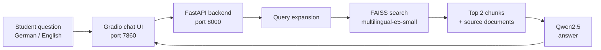

<div align="center">


[](https://riyazbiju.github.io/CAIRA/index%20(3).html)

**[What it does](#-what-it-does)** · **[How it works](#-how-it-works)** · **[Run it](#-run-it-in-5-steps)** · **[API](#-api)** · **[Deploy](#-production-deployment)** · **[Help](#-troubleshooting)**

</div>

---

## 🎓 What it does

CAIRA is a chat assistant for incoming students of the **Master of Artificial Intelligence (MAI)** program at THWS. It answers questions about admissions, courses, housing and campus life, using official THWS documents instead of guessing.

- Answers in **German and English**
- Shows the **source documents** behind each answer
- Handles short, vague or multi-part questions
- Runs **fully locally**, so no student question leaves the machine

> 👉 **New here?** Open the [interactive demo](https://riyazbiju.github.io/CAIRA/index%20(3).html) to follow a question through the system, step by step.

<details>
<summary><b>💬 What you can ask</b></summary>

<br>

| Topic | Example questions |
|:--|:--|
| **Admissions** | What are the admission requirements? |
| **Courses** | What subjects are in the AI Master? · How do I register for exams? |
| **Housing** | How do I find housing? · Wie finde ich eine Unterkunft in Würzburg? |
| **Campus** | What does the semester ticket cover? |
| **General** | Anything covered by the Würzburg guide and student documents |

</details>

---

## ⚙️ How it works



1. **Understand.** CAIRA expands vague or multi-part questions so nothing is missed.
2. **Search.** The question becomes a vector, and FAISS finds the closest chunks across all topics.
3. **Pick context.** The top 2 chunks (up to 600 characters each) go to the model with their sources.
4. **Answer.** Qwen2.5 writes the answer in the student's language, up to 150 new tokens.

<details>
<summary><b>🔧 Settings that keep it fast</b></summary>

<br>

| Setting | Value |
|:--|:--|
| Max new tokens | 150 (down from 256) |
| Context per chunk | 600 characters (down from 1000) |
| Chunks per question | 2 (down from 3) |
| Repetition penalty | 1.1 |
| Embeddings | `intfloat/multilingual-e5-small` |
| Vector search | FAISS |
| Model | Qwen2.5-1.5B-Instruct (local) · Qwen2.5-7B (production) |

</details>

<details>
<summary><b>⏱️ Speed: laptop vs production</b></summary>

<br>

| Setup | Time per question |
|:--|:--|
| Local CPU, Qwen2.5-1.5B | 30–60 seconds (normal) |
| Production GPU with vLLM, Qwen2.5-7B | 2–5 seconds (projected, not yet measured) |

</details>

---

## 🚀 Run it in 5 steps

**You need:** Python 3.13+, 8 GB RAM and [Tesseract OCR](https://github.com/tesseract-ocr/tesseract) for PDF processing.

```bash
# 1. Setup
git clone https://github.com/riyazbiju/CAIRA.git
cd CAIRA
python -m venv venv
source venv/bin/activate        # Windows: venv\Scripts\activate
pip install -r requirements.txt

# 2. Download the model (about 3 GB)
bash scripts/download_qwen.sh

# 3. Prepare the documents and build the search index
python scripts/pre_processing.py
python scripts/generate_embeddings.py
```

Then start the two parts in **two terminals**:

```bash
# Terminal 1: backend
python backend/main.py

# Terminal 2: chat UI
python frontend/app.py
```

Open **http://localhost:7860** and ask a question.

---

## 🔌 API

The backend runs on port **8000**. Interactive docs are at `http://localhost:8000/docs`.

| Endpoint | What it does |
|:--|:--|
| `GET /` | Health check |
| `GET /health` | Detailed status |
| `POST /ask` | Ask a question |
| `GET /stats` | System statistics |
| `GET /docs` | API documentation |

```bash
curl -X POST http://localhost:8000/ask \
  -H "Content-Type: application/json" \
  -d '{"question": "How do I find housing?", "top_k": 2}'
```

---

## 📁 Project structure

<details>
<summary><b>Show the folders</b></summary>

<br>

```
CAIRA/
├── backend/            FastAPI backend (main.py)
├── frontend/           Gradio chat UI (app.py)
├── scripts/
│   ├── pre_processing.py        clean and chunk the documents
│   ├── generate_embeddings.py   build the FAISS index
│   ├── rag_query.py             retrieval
│   ├── rag_with_llm.py          retrieval + Qwen answer
│   └── download_qwen.sh         download the model
├── source-docs/        official THWS documents
├── preprocessed/       chunks and embeddings
├── models/             qwen2.5-1.5b (local) · qwen2.5-7b (production)
├── index (3).html      interactive demo page
├── banner (1).svg      animated README banner
├── start_caira.sh      start script
├── Thws-logo_English.png · background_img.png · chat_thumbnail.jpeg
└── requirements.txt
```

</details>

---

## 🏭 Production deployment

<details>
<summary><b>Set it up on a university server</b></summary>

<br>

1. Set `API_URL` in `frontend/app.py` to the server's address on port 8000.
2. Serve the model with vLLM's OpenAI-compatible API server.
3. Change `scripts/rag_with_llm.py` to call the vLLM API.
4. Put nginx in front: `/api` goes to port 8000 and `/` goes to port 7860.
5. Turn on HTTPS with Let's Encrypt.

</details>

---

## 🛠️ Troubleshooting

<details>
<summary><b>Something is not working</b></summary>

<br>

| Problem | What to try |
|:--|:--|
| Backend won't start | Check that the virtual environment is active and the model is downloaded |
| No responses in the chat | Make sure the backend is running on port 8000 before you start the UI |
| Model download fails | Run `bash scripts/download_qwen.sh` again and check your connection |
| Answers are slow | Normal on CPU (30–60 s). Use a GPU and the 7B model for production |
| PDFs are not read | Install Tesseract OCR |

</details>

---

## 📚 Data and credits

- **Data:** official THWS MAI documents on admission, housing, courses, the Würzburg guide and general student topics.
- **Built with:** [Qwen2.5](https://github.com/QwenLM/Qwen2.5), [FAISS](https://github.com/facebookresearch/faiss), [FastAPI](https://fastapi.tiangolo.com/) and [Gradio](https://www.gradio.app/).
- **License:** free for personal and educational use.

<div align="center">

Built by **[Riya Biju](https://riyazbiju.github.io)** for THWS MAI students · © 2025–2026 CAIRA Team

</div>
